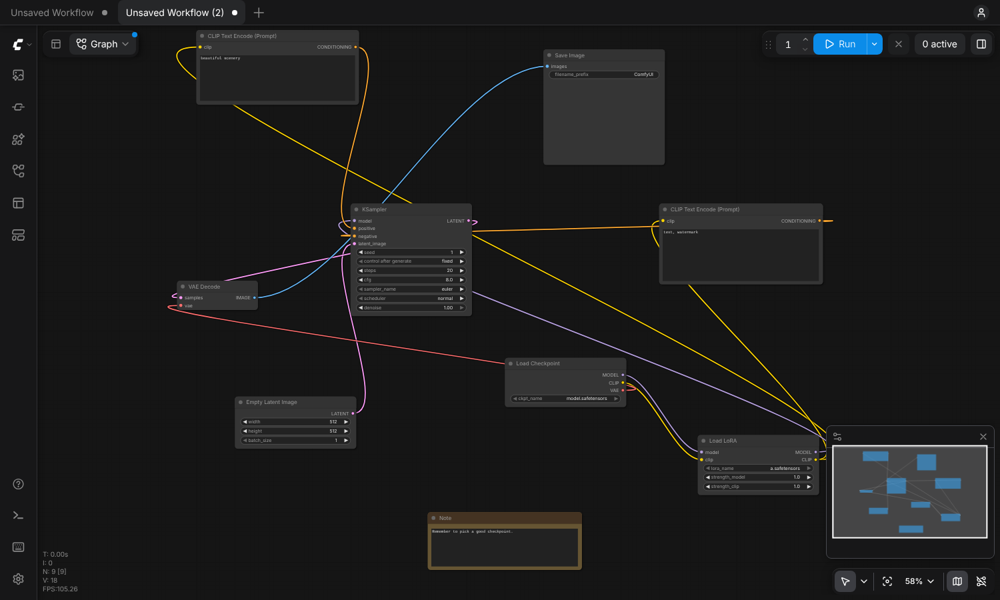
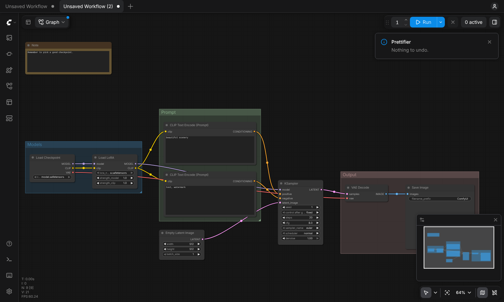
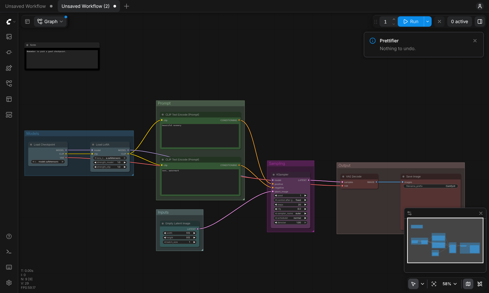

# ComfyUI Prettifier

Turns a tangled ComfyUI workflow into a clean, readable one with a single shortcut.
It lays nodes out along the flow of the graph, straightens links, resizes nodes,
creates or tidies groups, and gives you a lot of knobs to make the result look the
way you like.

| Before | After (default options) |
| --- | --- |
|  |  |

With the *Presentation* preset (stage groups and node colors):



## Install

Copy (or clone) this folder into `ComfyUI/custom_nodes/`, so you have
`ComfyUI/custom_nodes/ComfyUIPrettifier/__init__.py`, then restart ComfyUI and
refresh the browser. It is frontend-only: no Python dependencies, no new nodes.

## Use it

| How | What |
| --- | --- |
| **Alt + P** | Prettify (the selection if 2+ nodes are selected, otherwise the whole workflow) |
| **Alt + Shift + P** | Open the options dialog with live preview |
| Top menu → **Extensions → Prettifier** | All commands, plus an *Align selected* submenu |
| Right-click the canvas → **Prettifier** | Same commands |
| **Settings → Prettifier** | Every option, saved with your ComfyUI settings |

Prettify records an undo step with ComfyUI's normal history (Ctrl+Z), and also has
its own **Undo last prettify** command.

### The options dialog

The dialog shows every option grouped in tabs. With **Live preview** on, the canvas
re-arranges as you change things; **Apply** keeps the result and **Cancel** (or Esc)
puts everything back. Presets (*Compact*, *Spacious*, *Presentation*, *Tidy only*)
set several options at once. **Apply** saves the options as your defaults; **Cancel** discards them.

## What it does

1. **Columns by flow.** Nodes are placed in columns following the links
   (a Sugiyama-style layered layout). Cycles are handled, and loaders can sit right
   next to the nodes that use them.
2. **Fewer crossings.** Nodes inside each column are reordered to reduce crossing
   links, using socket order as a tie-breaker (so a positive prompt lands above the
   negative one feeding the same KSampler).
3. **Straight links.** Each node is moved vertically so its sockets line up with
   the sockets it connects to, without ever overlapping.
4. **Sizing.** Nodes can be shrunk to fit their content, made a uniform width per
   column, or a fixed width. Nodes with images or text boxes are protected from
   shrinking unless you allow it.
5. **Groups.** Either keeps and tidies your existing groups, or creates new ones by
   pipeline stage (Models, Inputs, Prompt, Sampling, Latent, Image, Mask, Output),
   node category, or connected section. Grouped nodes are laid out together and
   groups never overlap.
6. **Extras.** Notes are gathered into a row, unconnected nodes are packed neatly,
   pinned nodes stay put, optional stage colors for nodes, link style, snap to grid,
   zoom to fit, and an animated transition.

Also included: align left/right/top/bottom/center, distribute, match width/height,
shrink to fit content, and fit groups to their nodes.

## Options

| Tab | Option | Default |
| --- | --- | --- |
| Layout | Flow direction (left→right / top→bottom) | Left to right |
| | Column assignment (balanced / early / late) | Balanced |
| | Vertical alignment (straighten links / top / center) | Straighten links |
| | Node alignment inside a column | Left |
| | Crossing reduction passes | 8 |
| | Link straightening iterations | 12 |
| | Respect current top-to-bottom order | On |
| Spacing | Horizontal gap / vertical gap / section gap | 80 / 40 / 160 |
| | Snap to grid, grid size | On, 10 |
| | Anchor (keep in place / move to origin) | Keep |
| Sizing | Node width (uniform per column / fit / fixed / don't change) | Uniform per column |
| | Fixed, minimum, maximum width | 320 / 200 / 600 |
| | Node height (fit / don't change) | Fit |
| | Also shrink nodes with images or text boxes | Off |
| Groups | Create groups by (auto / existing / stage / category / section / none) | Auto |
| | Minimum nodes per new group | 2 |
| | Category depth | 1 |
| | Group padding, title size | 20, 24 |
| | Group color (auto / stage / single / don't change), single color | Auto |
| Placement | Unconnected nodes (row below / column right / leave) | Row below |
| | Notes (row above / row below / leave) | Row above |
| | Separate sections (stack vertically / side by side) | Vertically |
| | Never move pinned nodes | On |
| Appearance | Node colors (keep / by stage / reset) | Keep |
| | Link style (keep / spline / linear / straight) | Keep |
| | Animate, duration | On, 350 ms |
| | Zoom to fit afterwards | Off |
| Behavior | Prettify what (auto / everything / selection) | Auto |
| | Show a summary message | On |

"Auto" grouping keeps your groups if the workflow has any, and otherwise groups by
pipeline stage. "No groups" removes groups in the area being prettified.

## Project layout

```
__init__.py        tells ComfyUI to serve ./web (no Python nodes)
web/prettifier.js  extension entry: commands, keybindings, menus, settings registration
web/settings.js    option schema, defaults, presets, settings read/write
web/layout.js      pure layout engine (no ComfyUI imports, unit-testable)
web/graph.js       LiteGraph adapter: read graph, apply result, snapshots, align tools
web/core.js        prettify / undo actions
web/dialog.js      options dialog with live preview
tests/             Node tests for the engine (node tests/test_layout.mjs --svg)
```

## Development

The engine runs in plain Node 18+:

```
node tests/test_layout.mjs          # invariants: no overlaps, groups don't overlap, flow goes forward
node tests/test_layout.mjs --svg    # also writes before/after SVGs to tests/out/
```

## Known limitations

- Native reroute points (the dots on links in newer frontends) are not moved;
  legacy Reroute nodes are laid out like any other node.
- Nested groups: nodes are laid out by their innermost group; outer groups are
  refit around their contents afterwards and may overlap neighbours.
- Inside a subgraph, the open subgraph is what gets prettified.
